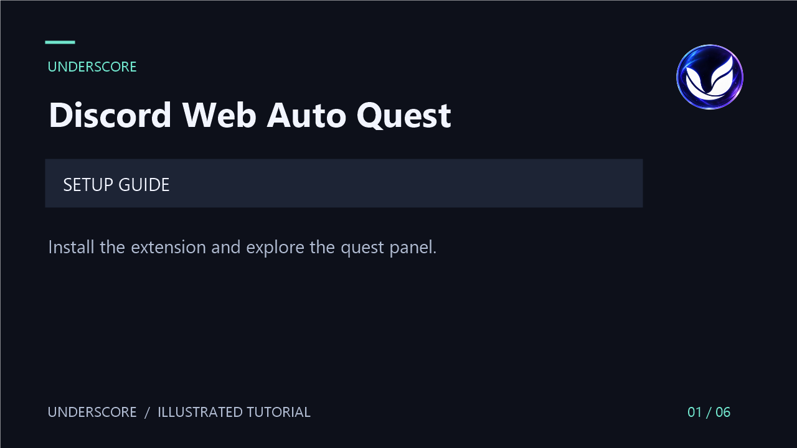

<p align="center">
  
</p>
<h1 align="center">UNDERSCORE</h1>
<p align="center">Discord Web Auto Quest Extension</p>
<p align="center">A compact quest panel with sequential quest processing.</p>

## Motion tutorial

[Watch the UNDERSCORE setup tutorial](assets/tutorial/underscore-tutorial.mp4)

A 36-second captioned motion guide to installation and the quest panel. These are illustrated instructions, not a live Discord recording. No audio is required.



## Installation

1. [Download the repository ZIP](https://github.com/underscoregang/quest-web-extension/archive/refs/heads/develop.zip) and extract it, or clone this repository.
2. Open `chrome://extensions` in Chrome or `edge://extensions` in Edge.
3. Enable **Developer mode**.
4. Choose **Load unpacked** and select the folder containing `manifest.json`.
5. Confirm that **UNDERSCORE - Discord Web Auto Quest** appears in the extensions list.

## How to use

1. Open [Discord Quests](https://discord.com/quest-home) and sign in.
2. Accept an available quest, then refresh the page.
3. Click **Running Quests** at the bottom right.
4. Expand the panel to view progress. **Copy JSON** copies the current quest progress data.
5. If progress stalls, press **F12** to inspect the browser console for errors.

The extension selects accepted, unexpired, unfinished quests with supported task types and processes them one at a time. Completion depends on Discord's behavior; support does not guarantee that every quest will complete.

## Supported task types

| Task | Identifier |
| --- | --- |
| Watch a video | `WATCH_VIDEO` |
| Watch a mobile video | `WATCH_VIDEO_ON_MOBILE` |
| Play on desktop | `PLAY_ON_DESKTOP` |
| Stream on desktop | `STREAM_ON_DESKTOP` |
| Play an activity | `PLAY_ACTIVITY` |

## Requirements and troubleshooting

Use a Chromium browser with extension support and a Discord account with an accepted quest. Mobile browsers must support loading extensions; installation controls vary by browser.

- **No button:** enable the extension, open `/quest-home`, and refresh.
- **No quests listed:** confirm that a supported quest is accepted, unfinished, and unexpired.
- **Progress stops:** inspect the console and reload the page. Discord changes may require an extension update.
- **After updating files:** click **Reload** on the extensions page, then refresh Discord.

## Project files

| File | Purpose |
| --- | --- |
| `manifest.json` | Manifest V3 configuration and logo paths |
| `quest-home.js` | Quest button, progress panel, and JSON export |
| `quest-code.js` | Quest discovery and sequential processing |
| `background.js` | Service worker and script injection |
| `user-agent-override.js`, `rules.json` | Browser user-agent overrides |
| `assets/icon.png` | Original UNDERSCORE artwork |
| `assets/Logo/` | Extension icons in six sizes |
| `scripts/build-tutorial.ps1` | Reproducible motion tutorial source |

To rebuild the tutorial on Windows, install FFmpeg with `libx264` support and run:

```powershell
powershell -ExecutionPolicy Bypass -File scripts/build-tutorial.ps1
```

The video is a silent, captioned 1280 x 720 MP4, with six animated scenes at 30 frames per second.

## Credits and license

Maintained under the **UNDERSCORE** name. Original quest script by [aamiaa](https://gist.github.com/aamiaa/204cd9d42013ded9faf646fae7f89fbb), with prior extension work by [yuuslokrobjakkroval](https://github.com/yuuslokrobjakkroval/peachy-quest-web-extension).

See [LICENSE](LICENSE) and [Privacy](PRIVACY.md).

> [!WARNING]
> This extension automates quest activity and modifies browser behavior. Using it may violate Discord's terms and put your account at risk. It is not affiliated with or endorsed by Discord.
